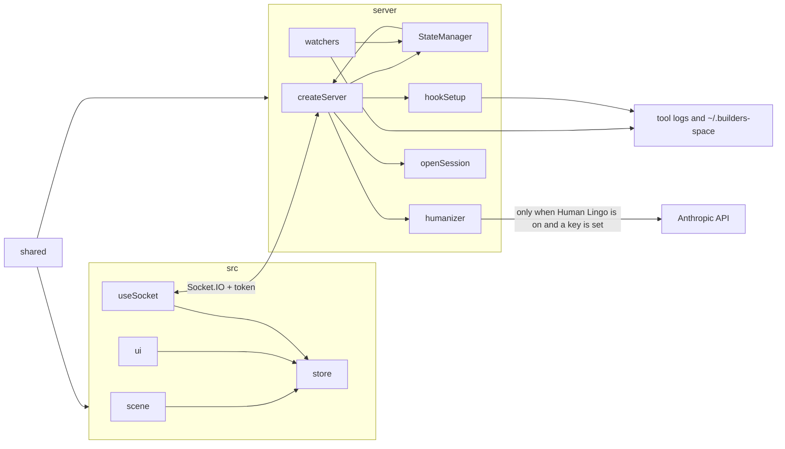

# Builders Space

https://github.com/user-attachments/assets/5118a62b-e610-43ef-b556-1169afeac5e7

An ambient awareness dashboard for multi-agent coding work, rendered as an immersive deep-space scene. Each of your projects appears as a planet. Each coding agent (Claude, Codex, Cursor) working on a project appears as a worker on that planet's surface. Expanding status rings around a planet signal when it needs your attention — red for errors, amber for waiting. Technical jargon is translated into human lingo so you always know what's happening at a glance.

## Why This Exists

If you use AI coding tools — Cursor, Claude Code, Codex — you've probably had three or four of them running at once across different projects. Each tool has its own window, its own logs, its own technical language. If one gets stuck and needs your input, you might not notice for twenty minutes. If one hits an error, you find out when you eventually switch back to that tab.

Builders Space exists because there was no single place to answer the question: _"What are all my agents doing right now, and does any of them need me?"_

The answer should take one glance, not five tab-switches. That's the core idea — **ambient awareness**. The dashboard sits in a corner of your screen and you absorb the state of everything peripherally, the same way you'd notice a red light on a car dashboard without actively reading the instrument cluster.

## Design Principles

1. **Ambient awareness over active monitoring.** You should never have to read a log or click into a panel to know the overall state. Color, motion, and scale do the work — red rings pulse when something breaks, amber rings breathe when something waits, and idle planets dim. Your peripheral vision catches it.

2. **Attention-first hierarchy.** Every status surface — sidebar dot, planet rings, HUD counter — shows the _most urgent_ state, not the most common. One error agent among five working agents means red, not green. The system is designed around what needs _you_, not what's going well.

3. **Visual coherence.** Every element maps to something real. Stars are ambient background. Nebulae are atmospheric depth. Planets are projects. Workers are agents. Nothing is decorative if it could be mistaken for a meaningful object.

4. **Plain language by default.** Technical jargon like `git diff HEAD~3` is translated into phrases like "Reviewing recent changes." The dashboard is legible to anyone, not just developers.

5. **Tool-agnostic.** Cursor, Claude Code, and Codex disagree on what an "agent" even is. Builders Space doesn't care. If it works on a project and has a status, it's a worker on a planet. All tools are treated as equals.

6. **Zero configuration for discovery.** The app discovers active sessions automatically from the standard directories each tool already writes to. No project registration. Hook installation is a separate opt-in: it runs only when you click Enable Hooks, it edits global tool config only, and Disable Hooks removes those edits.

## The Visual Metaphor

Every visual element in Builders Space maps to something real. Nothing is decorative-only if it could be confused with a meaningful object -- coherence is a core design principle.

| Real World                                         | Builders Space                                                                     | Why                                                                                                                    |
| -------------------------------------------------- | ---------------------------------------------------------------------------------- | ---------------------------------------------------------------------------------------------------------------------- |
| Your workspace                                     | Deep space                                                                         | The void you build within                                                                                              |
| A project (git repo)                               | A planet                                                                           | Each project is a self-contained world                                                                                 |
| A project                                          | Planet (uniform size)                                                              | All planets are the same size — visual consistency aids navigation                                                     |
| Where a planet sits in space                       | Concentric rings, alphabetical by project name                                     | Placement is **stable** while the project list is unchanged — agent status and activity timestamps do not move planets |
| Project identity                                   | Planet color and terrain                                                           | Seeded from project name; the same project always looks the same                                                       |
| Planet visual type                                 | One of 5 archetypes (gas giant, rocky, oceanic, volcanic, ice)                     | Purely cosmetic variety inspired by NASA exoplanet diversity; does not map to any project property                     |
| A coding agent (Claude / Codex / Cursor)           | A worker on the planet surface                                                     | Workers actively building on the world                                                                                 |
| Planet needs attention                             | Expanding status rings (HUD overlay)                                               | Red rings = error (fast, multiple, flickering). Amber ring = waiting (slow, single, calm). No ring = no action needed  |
| Planet idle                                        | Dimmed, desaturated, near-still planet                                             | Like a shop with the lights off — the eye naturally skips over it                                                      |
| Agent actively working                             | Worker digging or walking, kicking up dust and debris                              | Visibly busy — you can see the work happening                                                                          |
| Agent hit an error                                 | Worker trembling, red eyes, sparks and embers rising                               | Something broke — immediately visible distress                                                                         |
| Agent waiting for you                              | Worker sitting with animated "..." thought bubble                                  | Needs your input before it can continue                                                                                |
| Agent done                                         | Listed in the agent cards with its last action shown                               | Finished; no action needed from you                                                                                    |
| Technical jargon (`git diff`, `npm install`, etc.) | Human Lingo status labels ("Reviewing recent changes", "Installing project tools") | Always human-readable, never developer jargon                                                                          |

### Status system

The same 4-state hierarchy applies everywhere — sidebar dot, planet status rings, planet label. The most urgent status always wins:

| Priority | Status      | Color           | Planet visual                                      | What it means                                                                |
| -------- | ----------- | --------------- | -------------------------------------------------- | ---------------------------------------------------------------------------- |
| 1        | **Error**   | Red `#ff4444`   | 3–4 fast red rings expanding outward, flickering   | An agent hit a failure. Go investigate.                                      |
| 2        | **Waiting** | Amber `#ffaa44` | Single slow amber ring, calm radar pulse           | The agent finished its turn and needs your input.                            |
| 3        | **Working** | Green `#44ffaa` | No ring — planet at full color and normal rotation | Agents are writing, or a live process has not handed the turn back.          |
| 4        | **Done**    | Dim `#6688aa`   | No ring — planet dimmed, desaturated, near-still   | Quiet, with no finished turn and no live process. Nothing is asking for you. |

If a project has 3 working agents and 1 error agent, the planet shows red rings — because the error needs your attention regardless of the working agents. The sidebar dot matches.

**Waiting is not silence.** A transcript that has not been written for a few minutes is not "needs you". That status means the last message is a completed assistant turn (including a question), or a hook Stop event said the turn ended. A live process that has not handed the turn back stays **working** — quiet, possibly still busy. With no live process and no finished turn, the agent is **done**. Each agent carries `lastActivityMs` (and `quietForMs` at publish time) so a later UI can show how long it has been quiet. File age alone never sets waiting.

### What the background elements are (and are not)

- **Stars** (tiny white/blue dots): Ambient background. They are small and point-like -- they cannot be confused with planets.
- **Nebula** (very faint, very large colored washes): Atmospheric depth. They are so diffuse and transparent that they read as gas clouds, not solid objects. They are not planets.

## FAQ

**Why does a planet have red/amber rings when most agents are working fine?**

The status hierarchy prioritizes what needs your attention. If one agent has an error, the planet shows red rings even if five other agents are working normally — because the error needs you to act. The sidebar dot follows the same rule. You can click the planet to see the full breakdown of all agents.

**Why don't done agents appear on the planet surface?**

The pixel-art surface view shows agents you need to be aware of — working (productive), error (broken), and waiting (needs your input). Done agents only appear in the agent card list below the surface. They've finished their work and don't need your attention.

**What does the "Human Lingo" toggle do?**

It translates raw agent output (like `Running: git diff HEAD~3...HEAD -- src/`) into short human-readable labels (like "Reviewing recent code changes"). When `ANTHROPIC_API_KEY` is set, those short action and error strings are sent to Anthropic (at most 20 strings, 500 characters each). Without a key, labels stay on this machine and use the built-in fallback. Toggle it off to see the raw output.

**Why do error agents tremble and have red eyes?**

Every animation maps to a status. Trembling + red eyes + rising embers reads as "malfunctioning" at a glance. Working agents walk or dig (productive). Waiting agents sit with an animated "..." thought bubble (needs your input). The visual language is consistent: if a sprite is shaking, something is wrong; if it has a thought bubble, it's waiting for you.

**What does clicking an agent card do?**

It asks the local server to open that agent. The dashboard sends the agent id only. Cursor opens that project's folder in Cursor. Claude Code and Codex resume the session in Terminal when it is not already working, or open the project folder in Terminal when it is.

**How are projects discovered?**

Projects only appear if they have at least one active agent session. The backend watches standard tool directories (`~/.cursor/projects/`, `~/.claude/projects/`, `~/.codex/sessions/`) for session files. No configuration needed — if an agent is running, its project appears as a planet.

**Where does each planet sit in space?**

Alphabetically by project name on concentric rings in a flat plane. Agent status and activity do not move planets — only the project list (names) does. See `FAQ.md` for detail.

## Prerequisites

- [Node.js](https://nodejs.org/) 22.22.2 or newer (see `.nvmrc`; Node 20 is not supported)
- npm 9+
- macOS for live agent detection (`open` / `osascript` and the tool log paths). CI runs the automated suite on Linux.

## How to Run

```bash
# Install dependencies
npm install

# Copy the example env file and add your Anthropic API key (optional — enables LLM-powered jargon translation)
cp .env.example .env

# Start the app (backend + frontend together)
npm run dev
```

This starts:

- A **backend server** on `http://127.0.0.1:3002` (loopback only) with independent file watchers for each agent tool
- A **frontend** on `http://127.0.0.1:5174` that renders the 3D space

Open the frontend at that address. The dev server injects a per-launch token so the page can call the API. Nothing else on the network, and no other website, can.

Session discovery only reads tool logs. It does not modify your repositories or `~/.claude`, `~/.cursor`, or `~/.codex`.

A **Hooks** tool icon sits in the bottom-right corner of the dashboard. Click **Enable Hooks** to install shell hooks into the global Claude Code, Cursor, and Codex configs. That is opt-in: Builders Space does not write `.codex/hooks.json` into your repos, and it does not edit those global configs until you click. **Disable Hooks** removes the hooks and deletes config files that Enable created. If an older build wrote `<repo>/.codex/hooks.json`, delete that file when it only references `~/.builders-space/hooks/`. When hooks are active and events are recent, agents can report `statusSource: 'realtime'`. If hook data goes stale, agents fall back to file-scanning heuristics.

## Privacy and security

The dashboard reads session logs that already exist on this machine. It does not upload those logs. The only network call to a third party is Human Lingo, and only in the cases below. Report a vulnerability the way [SECURITY.md](SECURITY.md) describes.

### What is read locally

While the server is running it reads:

- Claude Code session logs under `~/.claude/projects/` (`*.jsonl`)
- Cursor agent transcripts under `~/.cursor/projects/*/agent-transcripts/` (`*.jsonl` and `*.txt`)
- Codex session logs under `~/.codex/sessions/` (`*.jsonl`) and `~/.codex/session_index.jsonl`
- Hook event files under `~/.builders-space/events/`, only after you enable hooks and a tool writes one
- The working directory of running `claude` and `codex` processes, via `ps` and `lsof`

Sessions whose files are older than 48 hours are dropped. The server uses the path, prompt, last action, and status from those logs. It does not read your repository source.

### What is sent to Anthropic, and how to turn that off

Nothing is sent unless both of these are true: `ANTHROPIC_API_KEY` is set in the environment (`.env` or `.env.local`), and the **Human Lingo** toggle in an open project panel is on.

When both are true, opening a project panel sends that panel's short action and error strings to Anthropic (`messages.create`, model `HUMANIZER_MODEL` or `claude-haiku-4-5-20251001`). A request is at most 20 strings, and each string is at most 500 characters. Full transcripts, file contents, and hook payloads are not included.

To keep every label on this machine, turn Human Lingo off, or leave `ANTHROPIC_API_KEY` unset. With no key, the server uses its built-in wording and does not call Anthropic.

### Localhost and the launch token

The server listens on `127.0.0.1` and, when that address is available, `::1`. It does not listen on other interfaces. A browser request is rejected unless its `Origin` is `http://localhost`, `http://127.0.0.1`, or `http://[::1]`, with an optional port.

Each launch writes a random token to `~/.builders-space/auth-token` (mode `0600`). The Vite dev server injects that token into the page only after the connection is accepted. HTTP routes send it as `Authorization: Bearer`, and the Socket.IO connection sends it as well.

The API and the Vite dev server also check the operating-system user on the other end of the TCP connection. On Linux that uid comes from `/proc/net/tcp` (and `/proc/net/tcp6`). When those tables are not there, the server uses `lsof`. The peer uid has to be the user who started the process. Another account on the machine is rejected even with the token, and a connection whose uid cannot be shown is rejected too. A page on another origin still cannot read the dashboard: the server is loopback-only, foreign origins get 403, and Vite does not send `Access-Control-Allow-Origin`. Request bodies are parsed only after the peer, origin, and token checks. Failures are JSON and do not include a stack trace.

Opening an agent sends the agent id only. The server looks the session up in its own state and runs a fixed program with an argument array (`open` or `osascript`). The request does not supply a shell command or a path.

### What Enable Hooks and Disable Hooks change

Discovery does not write anything. **Enable Hooks** is a separate click. It writes `~/.builders-space/hooks/status-hook.sh` and `fire-hook.sh` (mode `0755`) and `~/.builders-space/hook-manifest.json` (mode `0600`). It then edits the global tool configs, after copying an existing file into `~/.builders-space/backups/`:

- `~/.claude/settings.json`
- `~/.cursor/hooks.json`
- `~/.codex/config.toml` and `~/.codex/hooks.json`

Those hooks append small JSON payloads to `~/.builders-space/events/` (directory mode `0700`, files created with `umask 077`). The server applies an event once and deletes the file. It does not write `.codex/hooks.json` into your repositories.

**Disable Hooks** removes the Builders Space entries from those global configs. Config files that Enable created are deleted. The two hook scripts and the manifest are deleted. Backup copies under `~/.builders-space/backups/` are left in place. Hook status overlays are cleared, and agents go back to file and process inference.

## Architecture

`shared/` is the contract both sides import: types, ports, status priority, and humanize limits. `server/` watches local tool logs and serves state. `src/` renders that state. Neither side redefines the other's types.



**Backend** uses independent watchers that each monitor a tool's session directory:

- **CursorWatcher**: Agent transcripts in `~/.cursor/projects/` (`*.jsonl` and `*.txt`). Cursor does not spawn a process per chat, so liveness is the editor's cwd plus workspace paths on the `cursor` command line (`ps` / `lsof`), the same snapshot Claude and Codex use for their own processes.
- **ClaudeWatcher**: JSONL session files in `~/.claude/projects/`, with `ps aux` process detection
- **CodexWatcher**: Rollout JSONL files in `~/.codex/sessions/`, with `ps aux` process detection
- **EventWatcher**: Hook events written to `~/.builders-space/events/` — normalizes events into `HookRuntimeEntry` overlays for the StateManager. Applied overlays are saved to `~/.builders-space/hook-runtime.json` (mode `0600`) and reloaded on startup until their TTL.

Each watcher discovers projects agent-first: a project only exists if it has at least one agent session. Project paths come from the session's real `cwd` when the log has one. When it does not, the encoded directory name is resolved from `/` by probing the filesystem, longest directory first, so a folder named `my-app` stays intact and a root such as `/opt`, `/tmp`, or `/Volumes` works when that directory exists. If nothing on disk matches, the name falls back to splitting well-known parent folders (including `Projects`) and keeping the rest hyphenated, not the last word of a hyphenated folder. When the path does resolve, the display name is that directory's basename (`weather-widget-pro`, not `Pro`). Sidebar, planet labels, and the project panel all title-case that name the same way, and short tokens such as `api` and `ml` stay uppercase. Watchers also listen for directories being added and removed, so a new project appears and a deleted one disappears without waiting for the 60 second rescan. The **StateManager** merges project maps from all watchers, then applies hook overlays using an explicit authority model: any agent with a trusted, non-expired hook overlay becomes `statusSource: 'realtime'`; otherwise the watcher-derived heuristic is `statusSource: 'inferred'`. **Matching** overlays to agents uses that agent's own `session_id` and, when several events share it, the newest `lastEventAt`. Working directories are stored without a trailing slash, so `/proj/` and `/proj` are the same overlay. An event for one session does not change other agents in the same project. An event with no session id is applied only when the project has a single agent from that tool. Overlay trust windows: 10 minutes for active states (`working`, `waiting`), 1 hour for terminal states (`done`, `error`). State is emitted to clients via Socket.IO.

**Humanization** is client-initiated: when a user opens a project panel with "Human Lingo" mode on, the client sends raw action strings to the server, which translates them via LLM (with a regex fallback) and returns short labels.

**Frontend** renders a full 3D scene using React Three Fiber (a React wrapper for Three.js). Planets are procedurally generated using GLSL shaders -- no image textures are needed.

## Project Structure

```
builders-space/
├── index.html                  HTML shell
├── package.json                Dependencies and scripts
├── tsconfig.json               TypeScript config
├── vite.config.ts              Vite dev server and build
├── vitest.config.ts            Unit tests and coverage thresholds
├── playwright.config.ts        Browser tests
├── .env.example                Environment variable template
├── shared/                     Types, ports, status priority, humanize limits
│   ├── types.ts                Agent, project, and socket payload types
│   ├── config.ts               Ports, TTLs, humanize caps
│   ├── status.ts               Status priority shared by server and UI
│   └── humanize.ts             Client-side input bound before a request
├── server/
│   ├── index.ts                Process entry: loopback listen and launch token
│   ├── createServer.ts         Express 5 and Socket.IO
│   ├── security.ts             Origin check and per-launch token
│   ├── openSession.ts          Argv-only agent launch
│   ├── stateManager.ts         Merge watchers, apply hook overlays, emit changes
│   ├── types.ts                Re-exports shared types; socket events stay here
│   ├── io/incrementalRead.ts   Tail session files instead of rereading them
│   ├── process/                Async ps and lsof, with a short-lived cwd cache
│   ├── schema/sessionLog.ts    zod checks for session log lines
│   ├── watchers/               Cursor, Claude, Codex, hook events, shared fs watch
│   ├── services/               hookSetup and humanizer
│   └── utils/                  Transcript parsers and project names
├── src/
│   ├── App.tsx                 Root component; the 3D scene is loaded lazily
│   ├── store.ts                Zustand store
│   ├── api.ts                  Authenticated fetch helper
│   ├── types.ts                Re-exports shared types
│   ├── hooks/useSocket.ts      Socket.IO connection
│   ├── scene/                  Canvas, planets, rings, starfield, orbital layout
│   └── ui/                     HUD, sidebar, project panel, surface, agent cards, hooks
└── e2e/                        Playwright smoke test against fixture sessions
```

Unit tests sit next to the code in `server/__tests__/`, `src/**/__tests__/`, and `*.test.ts`. [CONTRIBUTING.md](CONTRIBUTING.md) covers how to run them.

## Tech Stack

- **Frontend**: React 19, Three.js, React Three Fiber 9, Drei 10, Zustand, Vite 8
- **Backend**: Node.js, Express 5, Socket.IO, chokidar 5
- **Language**: TypeScript 5.9 throughout (TypeScript 7 is blocked by `typescript-eslint`)
- **Checks**: ESLint 10 with `@eslint-react`, Vitest 5, jsdom 30
- **Rendering**: Custom GLSL shaders for planets, stars, and nebula (Three.js `ShaderMaterial`, `RingGeometry`, additive blending)

## Checks

```bash
npm run typecheck
npm run lint
npm run format:check
npm run test:coverage
npm run build
npm audit --audit-level=high
npm run test:e2e
```

`npm test` runs the unit and component suite. `npm run test:coverage` enforces line coverage of at least 90% on `server/` and `shared/`, and 70% on `src/`. `npm run test:e2e` boots the server and the Vite app against fixture sessions. GitHub Actions runs the same steps on every push and pull request to `main`, on Node 22.22.2.

`npm install` installs a pre-commit hook (lint-staged) that lints and formats staged files. Node 22.22.2 or newer is required. See [CONTRIBUTING.md](CONTRIBUTING.md).

## License

[MIT](LICENSE)
