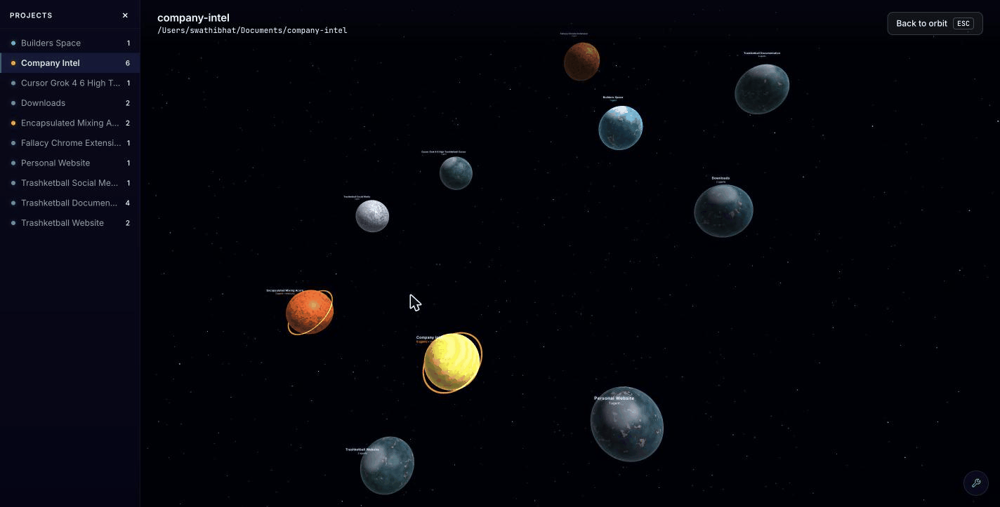

# Builders Space

An ambient awareness dashboard for multi-agent coding work, rendered as an immersive deep-space scene. Each of your projects appears as a planet. Each coding agent (Claude, Codex, Cursor) working on a project appears as a worker on that planet's surface. Expanding status rings around a planet signal when it needs your attention — red for errors, amber for waiting. Land on a planet and the agents working toward the same goal stand together under one banner naming it, so you read intent rather than tool calls.



*Orbit view, landing on a project, and reading what one agent needs from you.*

## Why This Exists

If you use AI coding tools — Cursor, Claude Code, Codex — you've probably had three or four of them running at once across different projects. Each tool has its own window, its own logs, its own technical language. If one gets stuck and needs your input, you might not notice for twenty minutes. If one hits an error, you find out when you eventually switch back to that tab.

Builders Space exists because there was no single place to answer the question: *"What are all my agents doing right now, and does any of them need me?"*

The answer should take one glance, not five tab-switches. That's the core idea — **ambient awareness**. The dashboard sits in a corner of your screen and you absorb the state of everything peripherally, the same way you'd notice a red light on a car dashboard without actively reading the instrument cluster.

## Design Principles

1. **Ambient awareness over active monitoring.** You should never have to read a log or click into a panel to know the overall state. Color, motion, and scale do the work — red rings pulse when something breaks, amber rings breathe when something waits, and idle planets dim. Your peripheral vision catches it.

2. **Attention-first hierarchy.** Every status surface — sidebar dot, planet rings, HUD counter — shows the *most urgent* state, not the most common. One error agent among five working agents means red, not green. The system is designed around what needs *you*, not what's going well.

3. **Visual coherence.** Every element maps to something real. Stars are ambient background. Nebulae are atmospheric depth. Planets are projects. Workers are agents. Nothing is decorative if it could be mistaken for a meaningful object.

4. **Intent over activity.** The surface never shows a tool call. It shows what an agent is *trying to achieve* — "Ship the checkout flow", not `git diff HEAD~3` — and when an agent has stopped, it names the **decision** now sitting with you. Agents end their turns with reports rather than clean questions, so that choice is worked out from the last message rather than relayed from it. The dashboard is legible to anyone, not just developers.

5. **Tool-agnostic.** Cursor, Claude Code, and Codex disagree on what an "agent" even is. Builders Space doesn't care. If it works on a project and has a status, it's a worker on a planet. All tools are treated as equals.

6. **Zero configuration.** The app discovers active sessions automatically from the standard directories each tool already writes to. No config files, no project registration, no setup beyond `npm run dev`.

## The Visual Metaphor

Every visual element in Builders Space maps to something real. Nothing is decorative-only if it could be confused with a meaningful object -- coherence is a core design principle.

| Real World | Builders Space | Why |
|---|---|---|
| Your workspace | Deep space | The void you build within |
| A project (git repo) | A planet | Each project is a self-contained world |
| A project | Planet (uniform size) | All planets are the same size — visual consistency aids navigation |
| Where a planet sits in space | Scattered through a volume on a phyllotactic spiral, nudged per name | Placement is **stable** while the project list is unchanged — agent status and activity timestamps do not move planets. The golden angle never closes into a ring, so it reads as a field rather than a circle |
| Project identity | Planet color and terrain | Seeded from project name; the same project always looks the same |
| Planet visual type | One of 5 archetypes (gas giant, rocky, oceanic, volcanic, ice) | Purely cosmetic variety inspired by NASA exoplanet diversity; does not map to any project property |
| A coding agent (Claude / Codex / Cursor) | A worker on the planet surface | Workers actively building on the world |
| Opening a project | The camera **descends and lands** on that planet | You go to the work rather than opening a panel about it |
| Planet needs attention | Expanding status rings (HUD overlay) | Red rings = error (fast, multiple, flickering). Amber ring = waiting (slow, single, calm). No ring = no action needed. Rings retire once you land — at that range they would wrap the whole sky |
| Planet idle | Dimmed, desaturated, near-still planet | Like a shop with the lights off — the eye naturally skips over it |
| Agent actively working | Worker digging or walking across the ground | Visibly busy — you can see the work happening |
| Agent hit an error | Worker trembling, red glowing eyes, embers rising | Something broke — immediately visible distress |
| Agent waiting for you | Worker seated with an animated "..." thought bubble | Needs your input before it can continue |
| Agent done | Absent from the surface; still counted in the sidebar and HUD | Finished; no action needed from you, so it takes up no ground |
| Agents pursuing the same goal | A **work party** under one shared banner | Four agents shipping one feature is one thing happening, and should read as one thing |
| What a party is building | A banner naming the goal in a few plain words ("Create social media artifact and post") | The goal is the smallest thing that survives a glance — a tool call is not an answer to "what is happening here" |
| What one agent contributes | A short line of intent under its name | Attached to the thing it is about, not filed in a list you have to cross-reference. An agent already under a banner stays quiet rather than repeating it |
| What a waiting agent needs from you | The **decision** now sitting with you, above its head | "Needs you" is only actionable if you can see what you must settle. Agents end with reports, not clean questions, so the choice is inferred rather than relayed |
| More agents than the ground can hold | The five most urgent stand; the sidebar and HUD still count them all | The scene stays readable at any agent count, and the counts never lie about how many there are |

### Status system

The same 4-state hierarchy applies everywhere — sidebar dot, planet status rings, planet label. The most urgent status always wins:

| Priority | Status | Color | Planet visual | What it means |
|---|---|---|---|---|
| 1 | **Error** | Red `#ff4444` | 3–4 fast red rings expanding outward, flickering | An agent hit a failure. Go investigate. |
| 2 | **Waiting** | Amber `#ffaa44` | Single slow amber ring, calm radar pulse | An agent needs your input. Go respond. |
| 3 | **Working** | Green `#44ffaa` | No ring — planet at full color and normal rotation | Agents are actively working. No action needed. |
| 4 | **Done** | Dim `#6688aa` | No ring — planet dimmed, desaturated, near-still | All agents finished. Nothing happening. |

If a project has 3 working agents and 1 error agent, the planet shows red rings — because the error needs your attention regardless of the working agents. The sidebar dot matches.

### Landing on a planet

Clicking a planet does not open a panel. The camera falls out of orbit and comes to rest standing on
that planet's surface, half a world-unit above the ground, with the horizon curving across the lower
third of the frame. The agents you need to be aware of are standing in front of you.

There is almost no rotation to schedule, because the camp is planted on the face of the sphere
already turned toward you: the camera is above that spot when you click, so the descent is a fall
straight down its own view ray. Levelling onto the local horizon is then a pure *pitch* about the
camera's own right axis — an aircraft flaring, not the world rolling. Hashing the landing site
instead, as this once did, put the camp anywhere on the sphere and cost up to 180 degrees of swing
and another 180 of roll; measured across ten planets that averaged 107 degrees of swing and 35 of
roll, against 14 and 7 now. What little remains is still spent in the first two thirds, because its
cost scales with how much of the frame is full of detail when it happens — a roll against starfield is
nothing, the same roll with ground filling the screen is genuinely nauseating. Distance eases
geometrically throughout, so the apparent zoom rate stays even across a ~13x change of scale.

The roll is not optional: landing sites are hashed anywhere on the sphere, so without it the horizon
arrives tilted, up to fully vertical for a site in the far hemisphere.

Once landed, drag slides your footing along the surface, and scroll changes your altitude.
OrbitControls is only used in the orbital view — orbiting a planet's centre is the wrong verb once
you are standing on it. `Escape` or **Back to orbit** flies you home.

The ground under you is a displaced patch of terrain rather than the smooth sphere: the same seeded
height field drives the mesh vertices, the camera's eye height and the agents' footing, so nobody
floats or sinks. It is what makes the horizon a ridged silhouette instead of a perfect arc.

Agents are lit geometry, not sprites — head, torso, arms and legs built from one shared box, posed by
rotating limbs, lit by the same sun as the terrain and casting real shadows onto it. They were pixel
art when the surface was a 100x60 thumbnail inside a panel; at landing range each of those ten
vertical art pixels covered a dozen screen pixels, and no amount of supersampling adds detail that
was never drawn. Geometry has no resolution to run out of.

### What the background elements are (and are not)

- **Stars** (tiny white/blue dots): Ambient background. They are small and point-like -- they cannot be confused with planets.
- **Nebula** (very faint, very large colored washes): Atmospheric depth. They are so diffuse and transparent that they read as gas clouds, not solid objects. They are not planets.

## FAQ

**Why does a planet have red/amber rings when most agents are working fine?**

The status hierarchy prioritizes what needs your attention. If one agent has an error, the planet shows red rings even if five other agents are working normally — because the error needs you to act. The sidebar dot follows the same rule. You can click the planet to see the full breakdown of all agents.

**Why don't done agents appear on the planet surface?**

The surface shows agents you need to be aware of — working (productive), error (broken), and waiting (needs your input). Done agents have finished and don't need your attention, so they don't take up ground. They're still counted in the sidebar and the HUD.

**Why aren't all my agents standing on the planet?**

The planet is small, so the horizon is close — about 0.8 world units of ground is visible before it curves away, and each agent needs a readable label above it. At most five stand on the ground at once, chosen by urgency: errors first, then agents waiting on you, then working ones — so whatever you would have looked at first is what stands. The sidebar and HUD keep counting everyone.

**What is a "work party"?**

Agents on the same project that were asked for the same outcome. Each party carries one banner naming that goal, so a planet with four agents shipping one feature reads as one line of text rather than four. Membership is decided per landing by a single LLM call over the agents' current tasks; an agent whose goal nobody shares just carries its own intent above its head.

**Why don't I ever see what command an agent is running?**

Because it does not help you decide anything. A chip reading "Editing surfacePlacement.ts" tells you an agent is busy, which you already knew from the fact that it is standing there. The surface shows intent instead — what the agent is trying to achieve, and, if it has stopped and asked you something, the question itself. There is no raw view and no jargon-translation layer.

**Why do error agents tremble and have red eyes?**

Every animation maps to a status. Trembling + red eyes + rising embers reads as "malfunctioning" at a glance. Working agents walk or dig (productive). Waiting agents sit with an animated "..." thought bubble (needs your input). The visual language is consistent: if a figure is shaking, something is wrong; if it has a thought bubble, it's waiting for you.

**What does clicking an agent chip do?**

It opens the tool where that agent lives. Cursor agents open the Cursor project window. Claude agents open the Claude desktop app. Codex agents open the Codex desktop app. If the desktop app isn't installed, it falls back to resuming the session in Terminal. The dashboard is a launchpad, not just a display.

**How are projects discovered?**

Projects only appear if they have at least one active agent session. The backend watches standard tool directories (`~/.cursor/projects/`, `~/.claude/projects/`, `~/.codex/sessions/`) for session files. No configuration needed — if an agent is running, its project appears as a planet.

**Where does each planet sit in space?**

Alphabetically by project name on concentric rings in a flat plane. Agent status and activity do not move planets — only the project list (names) does. See `FAQ.md` for detail.

## Prerequisites

- [Node.js](https://nodejs.org/) 18+ (LTS recommended)
- npm 9+ (ships with Node 18+)
- macOS (agent detection reads macOS-specific paths; Linux/Windows support is not tested)

## How to Run

```bash
# Install dependencies
npm install

# Copy the example env file and add your Anthropic API key
# (without it there are no goals, parties or decisions — agents show names only)
cp .env.example .env

# Start the app (backend + frontend together)
npm run dev
```

This starts:
- A **backend server** on `http://localhost:3002` with independent file watchers for each agent tool
- A **frontend** on `http://localhost:5174` (or next available port) that renders the 3D space

No configuration needed. The backend automatically discovers active agent sessions from standard tool directories.

A **Hooks** tool icon sits in the bottom-right corner of the dashboard. Click it to expand the hook setup panel, which lets you install shell hooks into Claude Code, Codex, and Cursor with one click. When hooks are active and events are recent, agents from all three tools can report `statusSource: 'realtime'` — lifecycle events (`sessionStart`, `postToolUse`, `stop`, `sessionEnd` for Cursor; PascalCase equivalents for Claude) drive working / waiting / done / error. If hook data goes stale, agents gracefully fall back to file-scanning heuristics. You can enable or disable hooks at any time.

## Architecture

```
Browser (React + Three.js)          Node.js Backend
┌─────────────────────────┐         ┌──────────────────────────┐
│  3D Space Scene         │◄─SIO──►│  StateManager (merge)     │
│  ├─ Starfield + Nebula  │         │  ├─ CursorWatcher         │
│  ├─ Planets (per project)│        │  ├─ ClaudeWatcher          │
│  │  └─ SurfaceView       │        │  ├─ CodexWatcher           │
│  │     (ground + agents) │        │  ├─ EventWatcher           │
│  ├─ CameraRig (descent) │         │  └─ Briefing (on-demand)   │
│  ├─ HUD + Surface Bar   │         └──────────────────────────┘
│  └─ HookSetupCard       │
└─────────────────────────┘
```

**Backend** uses independent watchers that each monitor a tool's session directory:
- **CursorWatcher**: Agent transcripts in `~/.cursor/projects/` (conversation JSONL files)
- **ClaudeWatcher**: JSONL session files in `~/.claude/projects/`, with `ps aux` process detection
- **CodexWatcher**: Rollout JSONL files in `~/.codex/sessions/`, with `ps aux` process detection
- **EventWatcher**: Hook events written to `~/.builders-space/events/` — normalizes events into `HookRuntimeEntry` overlays for the StateManager

Each watcher discovers projects agent-first: a project only exists if it has at least one agent session. The **StateManager** merges project maps from all watchers, then applies hook overlays using an explicit authority model: any agent with a trusted, non-expired hook overlay becomes `statusSource: 'realtime'`; otherwise the watcher-derived heuristic is `statusSource: 'inferred'`. **Matching** overlays to agents uses `session_id` / `conversation_id` first; if that does not line up with the transcript-derived id, a **cwd** match against the project path can still apply the overlay. Overlay trust windows: 10 minutes for active states (`working`, `waiting`), 1 hour for terminal states (`done`, `error`). State is emitted to clients via Socket.IO.

**What an agent is working on** comes from the **latest** meaningful user message in its transcript, never the first. All three CLIs inject machine-written turns into the user role — classifier prompts, command echoes, ambient UI state, compaction preambles — so `server/utils/userMessages.ts` is the single place that decides which turns are real human requests, working from prefixes measured across real rollouts rather than guessed. The same module supplies `question`: the agent's last outward-facing turn, when that turn is not a tool call and not a serialized classifier verdict.

**Briefing** is client-initiated and is the only LLM call in the app. On landing, the client sends the surface roster over `space:brief` — `{id, task}` per agent and nothing else, because that shape *is* the cache key and the state manager emits a fresh agents array several times a second. One structured-output call to `claude-sonnet-5` (override with `BRIEFING_MODEL`; effort with `BRIEFING_EFFORT`, default `low`) returns the work parties and each agent's intent in one answer, since which agents share a goal is not decidable without first naming the goals. It also names, for each agent that has stopped, the decision now sitting with the user — worked out from that agent's last message, which rides along only for agents actually waiting, where it is fixed. Spend is bounded by the shape of the request rather than the size of the model: a 30-minute content-keyed cache, in-flight de-duplication, and a 3-second floor that paces distinct calls by waiting rather than refusing. `repairBriefing` drops invented and duplicated ids and re-adds any agent the model forgot before the answer reaches the scene.

There is no rule-based second mechanism. When the call cannot run — no key, a failure, an answer too damaged to trust — the response is empty and agents carry their names alone. Grouping by exact task match used to fill that gap and was quietly dishonest: it split agents asked the same thing in different words, and it could name no decision at all, because reading past a report to the choice underneath is the judgement a rule cannot make.

**Frontend** renders a full 3D scene using React Three Fiber (a React wrapper for Three.js). Planets are procedurally generated using GLSL shaders -- no image textures are needed.

Selecting a project hands the camera to `CameraRig`, which owns it across four states: orbiting, descending, landed, and ascending. Ground detail mounts late in the descent, once the patch fills the frame and its rim is out of view. All of the surface geometry -- eye height, pitch, the agent band, terrain range, agent height, party label lift -- lives in `surfaceConstants.ts`; the placement, terrain, camera and figure modules all read from it, and the view only lines up because they agree. Descent progress is shared through a small module-level object rather than the store, since it is written every frame.

Grouping is layered on top of placement, never fed into it: `planSurfaceCamp` takes no briefing parameter, and `partyAnchor` derives a banner position by reading slots the camp has already decided. An asynchronous, cached, occasionally-fallback answer must not be able to rearrange the camp — an invariant test named `INVARIANT: grouping cannot move anyone` holds the line.

## Project Structure

```
builders-space/
├── index.html                       HTML shell
├── package.json                     Dependencies and scripts
├── tsconfig.json                    TypeScript config
├── vite.config.ts                   Vite build config
├── vitest.config.ts                 Vitest test runner config
├── .env.example                     Environment variable template
│
├── server/                          Node.js backend
│   ├── index.ts                     Express + Socket.IO server
│   ├── __tests__/                   Automated tests (vitest)
│   │   ├── stateManager.test.ts     StateManager authority model, overlay expiry, edge cases
│   │   ├── eventWatcher.test.ts     Event normalization, mode assignment, unknown events
│   │   ├── briefing.test.ts         Cache, de-duplication, repair and fallback (transport stubbed)
│   │   ├── userMessages.test.ts     Table-driven over the exported synthetic-prefix lists
│   │   ├── parseTranscript.test.ts  Latest-not-first task, question capture (tmpdir fixtures)
│   │   └── parseCodexSession.test.ts  Classifier prompts rejected, ambient-context unwrap
│   ├── types.ts                     Shared data types (AgentInfo, AgentStatusSource)
│   ├── stateManager.ts              Runtime authority: merges watcher state, applies hook overlays, emits changes
│   ├── watchers/
│   │   ├── cursorWatcher.ts         Cursor agent transcript watcher
│   │   ├── claudeWatcher.ts         Claude Code session watcher
│   │   ├── codexWatcher.ts          Codex rollout session watcher
│   │   └── eventWatcher.ts          Hook event watcher (status + error events)
│   ├── services/
│   │   ├── hookSetup.ts             Hook installation/removal (status + fire hooks)
│   │   └── briefing.ts              Work parties + per-agent intent (the only LLM call)
│   └── utils/
│       ├── parseTranscript.ts       Cursor/Claude transcript parser
│       ├── parseCodexSession.ts     Codex rollout JSONL parser
│       ├── userMessages.ts          Which transcript turns are real human requests
│       └── projectName.ts           Directory name → project name
│
└── src/                             React frontend
    ├── main.tsx                     Entry point
    ├── App.tsx                      Root component
    ├── types.ts                     Frontend type definitions
    ├── store.ts                     Zustand state store (dedupes agents by id)
    ├── hooks/
    │   ├── useSocket.ts             Socket.IO connection hook
    │   └── usePrefersReducedMotion.ts  Honours the reduced-motion media query
    ├── scene/
    │   ├── SpaceScene.tsx           Main 3D canvas, lighting, starfield, nebula
    │   ├── CameraRig.tsx            Camera across orbit / descent / landed / ascent
    │   ├── layout.ts                Stable orbital positions (name-sorted rings; unit-tested)
    │   ├── Starfield.tsx            Particle starfield (custom shader)
    │   ├── Planet.tsx               Procedural planet with type-based shader
    │   ├── PlanetLabel.tsx          Floating HTML label above each planet
    │   ├── surfaceConstants.ts      Canonical geometry for the landed view
    │   ├── surfaceCamera.ts         Camera poses and the descent path
    │   ├── surfacePlacement.ts      Where each agent stands, and where a party's banner hangs
    │   ├── surfaceTerrain.ts        Height field + displaced ground patch
    │   ├── agentMotion.ts           Which animation an agent plays, and how it moves
    │   ├── AgentFigure.tsx          One agent as posed, lit, shadow-casting geometry
    │   ├── PartyLabel.tsx           A work party's goal banner, lifted along the radius
    │   ├── SurfaceView.tsx          Ground patch, camp lighting, agents and party banners
    │   ├── descentState.ts          Descent progress shared with the frame loop
    │   └── __tests__/               Vitest tests for layout, camera, placement,
    │                                terrain and agent motion
    └── ui/
        ├── HUD.tsx                  Top bar with counters
        ├── Sidebar.tsx              Collapsible project index (left panel)
        ├── useOpenSession.ts        Opens an agent's session in its own tool
        ├── HookSetupCard.tsx        Hook management panel (persistent tool icon, enable/disable hooks)
        ├── briefingRequest.ts       Pure briefing DTO + request key (narrows to `{id, task}`)
        ├── useBriefProject.ts       Headless hook keeping the landed project's briefing current
        ├── agentIdentity.ts         Deterministic name/color identity for agents
        ├── planetIdentity.ts        Stable planet type and terrain palette per project
        └── __tests__/               Vitest tests for the briefing request key
```

## Tech Stack

- **Frontend**: React 18, Three.js, React Three Fiber, Drei, Zustand, Vite
- **Type**: Inter for UI, JetBrains Mono for paths and technical strings
- **Backend**: Node.js, Express, Socket.IO, chokidar, `@anthropic-ai/sdk` (structured outputs, for the briefing)
- **Language**: TypeScript throughout
- **Rendering**: Custom GLSL shaders for planets, stars, and nebula (Three.js `ShaderMaterial`, `RingGeometry`, additive blending); shadow-mapped `MeshStandardMaterial` for the landed surface and its agents

## License

[MIT](LICENSE)
